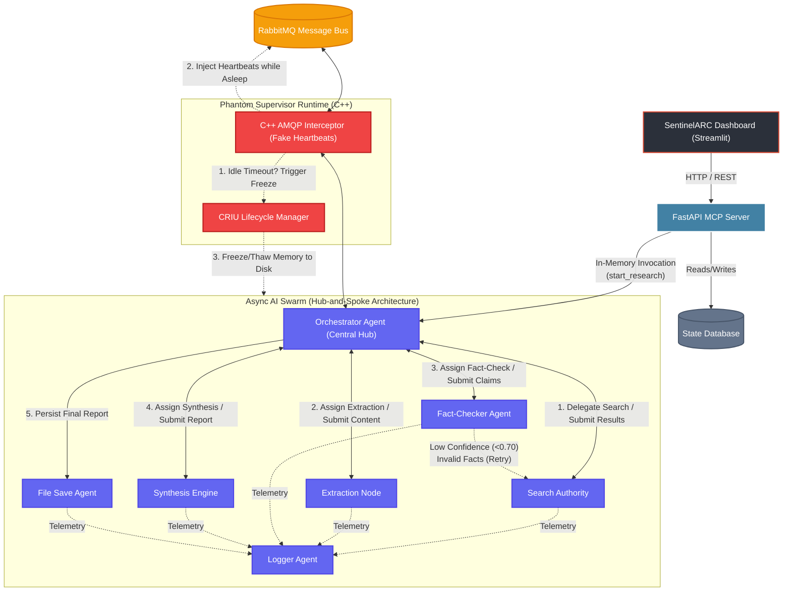

# SentinelARC

SentinelARC is a highly scalable, asynchronous multi-agent framework designed for automated academic research and synthesis. The system coordinates specialized AI agents to handle literature review, content extraction, and factual verification.

To support high-density deployments, SentinelARC introduces a custom C++ runtime based on CRIU (Checkpoint/Restore In Userspace) that dynamically swaps idle agents to disk, significantly reducing memory footprint while maintaining low latency.

## Key Features

* **Multi-Source Scholarly Retrieval:** Concurrently queries 250M+ research papers across OpenAlex, Semantic Scholar, arXiv, and PubMed, with direct DOI routing via Crossref and HyDE semantic query expansion.
* **Citation Velocity & Anchor Detection:** Dynamically detects seminal breakthrough papers using Citation Velocity ($\text{citations}/\Delta t$) and batch median outlier classification ($3\times \text{batch median}$), with 1-hop lineage expansion.
* **Full-Text Paywall Bypass & IMRAD Parsing:** Automated dual-layer open-access discovery via Unpaywall (`api.unpaywall.org`) and CORE API (`api.core.ac.uk`), combined with PyPDF2 stream parsing, IMRAD structure segmentation, reference stripping, and regex numerical benchmark extraction.
* **4-Layer Grounded Scientific Verification:** Frames fact-checking as formal Natural Language Inference (NLI: `ENTAILMENT`, `CONTRADICTION`, `NEUTRAL`) with quantitative benchmark anchoring, epistemic confidence weighting, and cross-document scientific consensus/debate detection.
* **5-Part Literature Survey Taxonomy:** Synthesizes 2,000+ word academic reviews with an Executive Verification Banner, automated Comparative Technical Matrix (Markdown table), and clickable inline citations `[Paper Title](URL)`.
* **Multi-Tier SQLite Caching:** Sub-millisecond memoization across search, document extraction, NLI verification, and report synthesis, dropping repeat query times to **$< 1\text{ second}$**.
* **High-Density Agent Runtime (Phantom Supervisor):** Custom C++ CRIU runtime dynamically freezes idle Python agents to disk, reclaiming 200–500MB RAM per idle agent while a C++ AMQP proxy maintains persistent RabbitMQ heartbeats.
* **Asynchronous Microservices & Streamlit UI:** Fully asynchronous Python backend using FastAPI, RabbitMQ, and Streamlit with zero-hang failure recovery.

## Architecture



## Getting Started

### Prerequisites
* Docker and Docker Compose
* Git
* Python 3.10+ (for local scripts)

### Running Locally

```bash
# Clone the repository
git clone https://github.com/Ashishparmar265/SentinelARC.git
cd SentinelARC

# Deploy infrastructure and build agents
docker-compose -f docker-compose.optimized.yml up --build -d

# Launch the frontend
streamlit run streamlit_app.py
```

## Project Structure

```text
SentinelARC/
├── phantom-supervisor/      # C++ Interceptor & CRIU Lifecycle Manager
├── src/                     # Core Python backend and API servers
│   ├── agents/              # Specialized async AI workers
│   ├── mcp_servers/         # Production REST interfaces
│   └── database.py          # State and report management
├── docs/                    # Architectural documentation
├── streamlit_app.py         # Frontend application
└── docker-compose.optimized.yml # Infrastructure definition
```

## Documentation

* [System Optimizations & Interview Study Guide](docs/OPTIMIZATIONS_AND_INTERVIEW_PREP.md): Deep-dive engineering breakdown of latency reductions, multi-source ingestion, citation velocity, 4-layer verification, and system design Q&A.
* [100 Technical Interview Questions](docs/INTERVIEW_QUESTIONS.md): 100 comprehensive technical and system design interview questions with detailed, authentic answers.
* [System Architecture](docs/ARCHITECTURE.md): Detailed infrastructure topology, swarm pipelines, multi-layer caching, and CRIU integration.
* [API & Protocols Reference](docs/API_REFERENCE.md): REST endpoints, Agent Communication Protocol (ACP) schemas, and SQLite database tables.
* [Phantom Supervisor Integration](Phantom_Supervisor_Integration.md): Technical breakdown of the AMQP heartbeat proxy.
* [System Validation Report](SYSTEM_VALIDATION_REPORT.md): Load testing and QA validation results.

## License

This project is licensed under the MIT License - see [LICENSE](LICENSE) for details.
