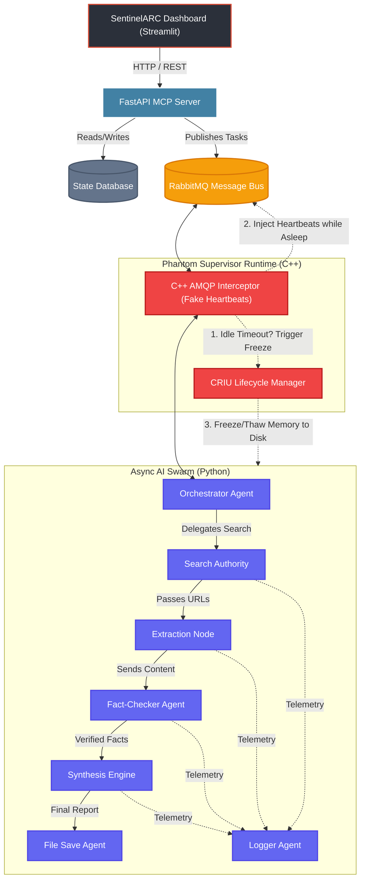

# SentinelARC

SentinelARC is a highly scalable, asynchronous multi-agent framework designed for automated academic research and synthesis. The system coordinates specialized AI agents to handle literature review, content extraction, and factual verification.

To support high-density deployments, SentinelARC introduces a custom C++ runtime based on CRIU (Checkpoint/Restore In Userspace) that dynamically swaps idle agents to disk, significantly reducing memory footprint while maintaining low latency.

## Key Features

* **High-Density Agent Runtime (Phantom Supervisor):** Uses CRIU to checkpoint and restore idle Python agents. Reclaims RAM from idle processes, increasing container density.
* **AMQP Connection Proxy:** A C++ interceptor proxy maintains persistent RabbitMQ connections and injects heartbeats while agents are suspended to disk.
* **Asynchronous Microservices:** Fully async Python backend utilizing FastAPI and RabbitMQ for message routing.
* **Streamlit Dashboard:** Integrated frontend interface for managing active research tasks and toggling between General AI and Swarm intelligence modes.

## Architecture



## Getting Started

### Prerequisites
* Docker and Docker Compose
* Git
* Python 3.10+ (for local scripts)

### Running Locally

```bash
# Clone the repository
git clone https://github.com/Ashishparmar265/SentinelARC.git
cd SentinelARC

# Deploy infrastructure and build agents
docker-compose -f docker-compose.optimized.yml up --build -d

# Launch the frontend
streamlit run streamlit_app.py
```

## Project Structure

```text
SentinelARC/
├── phantom-supervisor/      # C++ Interceptor & CRIU Lifecycle Manager
├── src/                     # Core Python backend and API servers
│   ├── agents/              # Specialized async AI workers
│   ├── mcp_servers/         # Production REST interfaces
│   └── database.py          # State and report management
├── docs/                    # Architectural documentation
├── streamlit_app.py         # Frontend application
└── docker-compose.optimized.yml # Infrastructure definition
```

## Documentation

* [System Architecture](docs/ARCHITECTURE.md): Detailed infrastructure topology and CRIU integration.
* [Phantom Supervisor Integration](Phantom_Supervisor_Integration.md): Technical breakdown of the AMQP heartbeat proxy.
* [System Validation Report](SYSTEM_VALIDATION_REPORT.md): Load testing and QA validation results.

## License

This project is licensed under the MIT License - see [LICENSE](LICENSE) for details.
