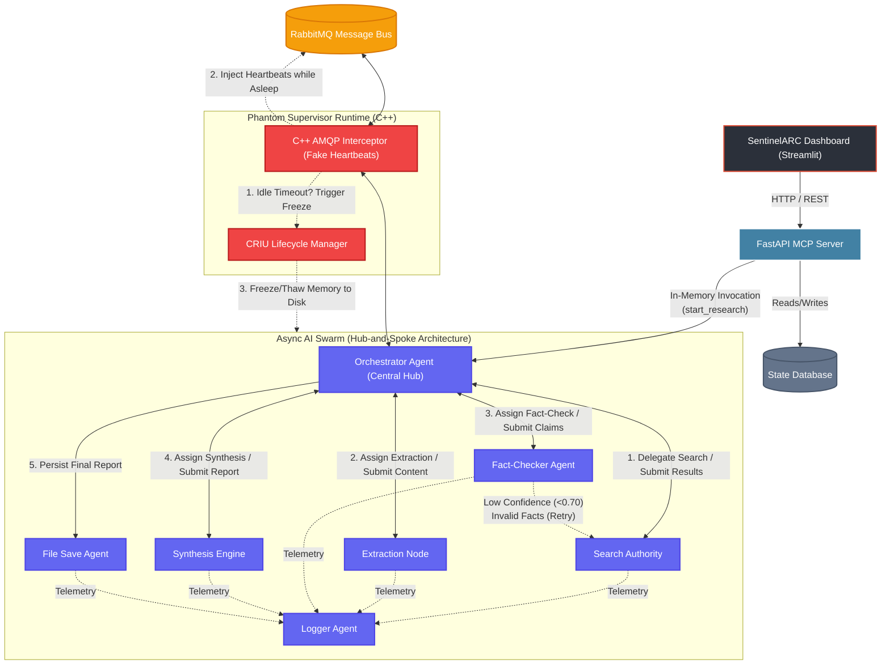

# SentinelARC Architecture Overview

This document provides a technical overview of the SentinelARC platform, focusing on its distributed microservice architecture, asynchronous messaging, and the proprietary Phantom Supervisor integration for high-density AI operations.

## 1. High-Level System Topology

SentinelARC is designed as a highly scalable, event-driven architecture that separates the user interface, routing logic, and heavy AI processing into isolated, independently scalable containers.



## 2. Component Deep Dive

### 2.1 The Streamlit Frontend (`streamlit_app.py`)
The user interface is a customized Streamlit application handling user interactions and visualization. 
- **Key Features**: Persistent control center sidebar, profile overlay, and a centralized search bar.
- **Modes**: Toggles between asynchronous swarm tasks ("Research AI") and synchronous chat ("General AI").

### 2.2 API & State Management (`async_main.py` & `src/database.py`)
The FastAPI backend serves as the primary gateway. It manages user authentication, persists generated reports, and initiates research workflows directly through the in-memory `AsyncOrchestratorAgent` (`state["orchestrator"].start_research`), which then delegates tasks across the RabbitMQ message bus.

### 2.3 The Message Bus (RabbitMQ)
RabbitMQ handles inter-service communication. It ensures reliable task delivery to the AI swarm under variable load and mitigates potential bottlenecks during agent cold starts.

### 2.4 Phantom Supervisor & AI Agents
To optimize for high memory density, idle AI agents are frozen to disk using **CRIU (Checkpoint/Restore In Userspace)**.
- **The Polling Challenge**: RabbitMQ requires active TCP heartbeats. When an agent is frozen, RabbitMQ would normally drop the connection due to timeout.
- **The Solution**: A custom C++ Interceptor proxy sits locally between the Python agents and the RabbitMQ server. 
- **Lifecycle**: 
  1. After 10 seconds of inactivity, the proxy signals the Lifecycle Manager to execute a `criu dump`, freezing the process.
  2. While the agent sleeps, the C++ proxy injects an 8-byte AMQP heartbeat frame to RabbitMQ.
  3. When a new payload arrives from RabbitMQ, the proxy buffers the data, triggers `criu restore` to wake the agent, and forwards the payload.

### 2.5 Swarm Agent Pipeline & Intelligence Core
The swarm executes a linear, decoupled 5-stage pipeline directed by `AsyncOrchestratorAgent`:

1. **Search Authority (`AsyncSearchAgent`):**
   * Multi-source concurrent gather across OpenAlex, Semantic Scholar, arXiv, PubMed, and Crossref.
   * Hypothetical Document Embeddings (HyDE) query expansion for niche academic recall.
   * Dynamic Citation Velocity ($\text{citations}/\Delta t$) and batch median outlier analysis ($3\times \text{batch median}$) to isolate Seminal Anchor papers.
   * 1-Hop citation tree lineage expansion from identified anchors.
   * In-memory memoization via `search_cache` table ($< 1\text{ms}$).

2. **Extraction Node (`AsyncExtractionAgent`):**
   * Bounded concurrency (`asyncio.Semaphore(5)`) processing up to 8 candidate papers.
   * Layered extraction cascade: Direct PyPDF2 byte-stream extraction $\rightarrow$ Primary Tooling MCP DOM extraction $\rightarrow$ Unpaywall Open-Access API (`api.unpaywall.org`) $\rightarrow$ CORE Institutional Repository API (`api.core.ac.uk`) $\rightarrow$ Peer-reviewed abstract fallback.
   * IMRAD structure segmentation (`abstract`, `introduction`, `methodology`, `results`, `conclusion`).
   * Reference section stripping past the 45% document mark to save 25–40% LLM context tokens.
   * Regex extraction of empirical `numerical_benchmarks` (percentages, latency, speedup factors).
   * Local memoization via `document_cache` table ($< 1\text{ms}$).

3. **Fact-Checker Agent (`AsyncFactCheckerAgent`):**
   * **4-Layer Scientific Verification Funnel:**
     * *Layer 1 (Grounded NLI):* Classifies Premise-Hypothesis relationship into `ENTAILMENT`, `CONTRADICTION`, or `NEUTRAL` with verbatim quote extraction.
     * *Layer 2 (Quantitative Anchoring):* Hard-checks numbers in claims against source text and benchmark tables to eliminate digit hallucinations.
     * *Layer 3 (Epistemic Weighting):* Calibrates confidence with Crossref DOI verification ($+0.05$) and citation authority ($+0.08$), while penalizing unanchored figures ($-0.15$).
     * *Layer 4 (Consensus Engine):* Detects `CONSENSUS` vs `CONTESTED / SCIENTIFIC DEBATE` across independent literature.
   * Sub-millisecond memoization via `fact_check_cache` table ($0.34\text{ms}$).

4. **Synthesis Engine (`AsyncSynthesisAgent`):**
   * Synthesizes a comprehensive 2,000+ word academic survey following an **IEEE/ACM 5-Part Survey Taxonomy**:
     1. Executive Overview & Problem Formulation
     2. Seminal Anchors & Foundational Paradigms (`[🏆 SEMINAL ANCHOR PAPER]`)
     3. Comparative Technical Methodologies & Empirical Benchmarks
     4. Scientific Debates, Contradictions & Empirical Trade-Offs
     5. Open Research Frontiers & Practical Deployment Challenges
   * Prepends an executive **🛡️ Scholarly Verification & Scientific Consensus Banner**.
   * Emits an automated **Comparative Technical Matrix** (Markdown table).
   * Enforces mandatory inline clickable citations: `[Paper Title](URL)`.
   * Multi-model failover: Groq `qwen/qwen3.8-27b` $\rightarrow$ `openai/gpt-oss-20b` $\rightarrow$ Deterministic structured markdown index.
   * Local memoization via `synthesis_cache` table ($< 1\text{ms}$).

5. **File Save Agent (`AsyncFileSaveAgent`):**
   * Resolves paths: `output/reports/{user_id}/research_report_{timestamp}.md`.
   * MCP Filesystem boundary validation with direct atomic write fallback.
   * Direct native `sqlite3` insertion into `output/sentinelarc.db` to immediately update Streamlit.

### 2.6 Multi-Tier Sub-Millisecond SQLite Caching Architecture
SentinelARC implements 4 dedicated cache tables in `output/sentinelarc.db` to enable instant ($< 1\text{s}$) repeat research queries:

```
┌────────────────────────────────────────────────────────────────────────┐
│                        SENTINELARC SWARM CACHE                         │
├─────────────────┬──────────────────────┬───────────────────────────────┤
│ Table Name      │ Key Digest           │ Cached Asset                  │
├─────────────────┼──────────────────────┼───────────────────────────────┤
│ search_cache    │ SHA-256(query, year) │ Deduplicated, reranked papers │
│ document_cache  │ SHA-256(url/doi)     │ Clean text, IMRAD, benchmarks │
│ fact_check_cache│ SHA-256(premise,claim│ NLI verdict, quote, confidence│
│ synthesis_cache │ SHA-256(query, [urls]│ Final 2,000+ word survey      │
└─────────────────┴──────────────────────┴───────────────────────────────┘
```

## 3. Deployment Specifications

The platform is fully containerized. While local development uses Docker Compose (`docker-compose.optimized.yml`), the architecture is designed for Kubernetes environments.

- **Privileged Containers**: The `synapse-agents` container requires `privileged: true` mode. This is mandatory for CRIU to access kernel namespaces and utilize `ptrace`.
- **Volume Mounts**: Agent memory state dumps are stored in a dedicated volume (`/snapshots`), enabling sub-500ms process restorations.
