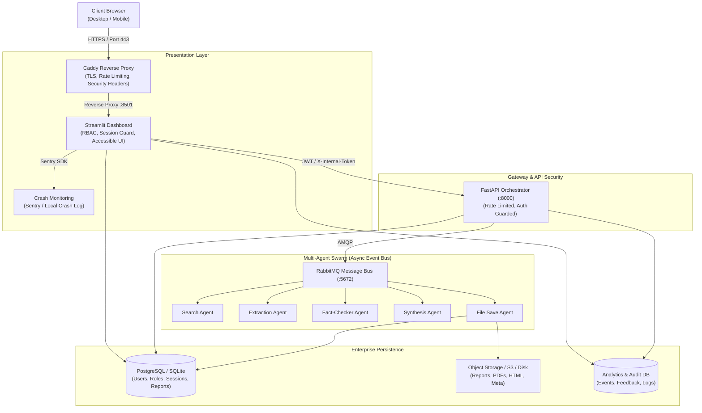
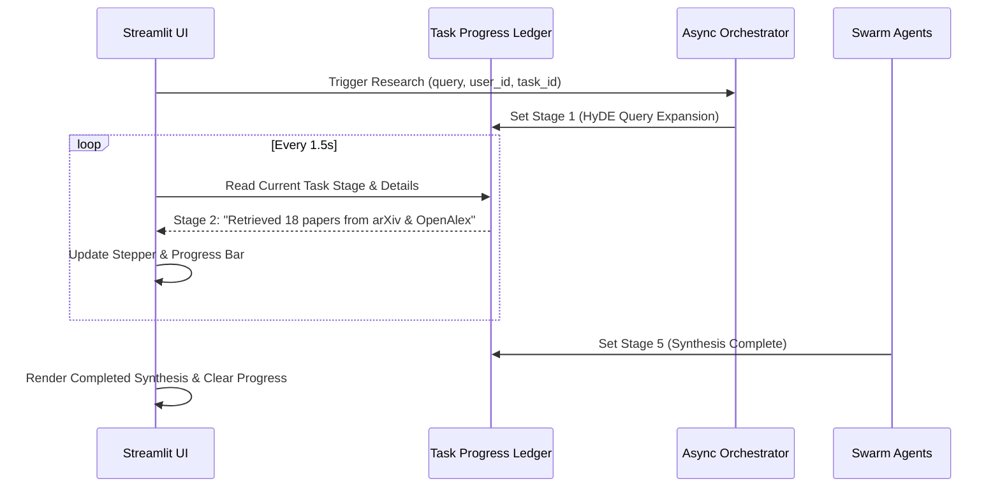
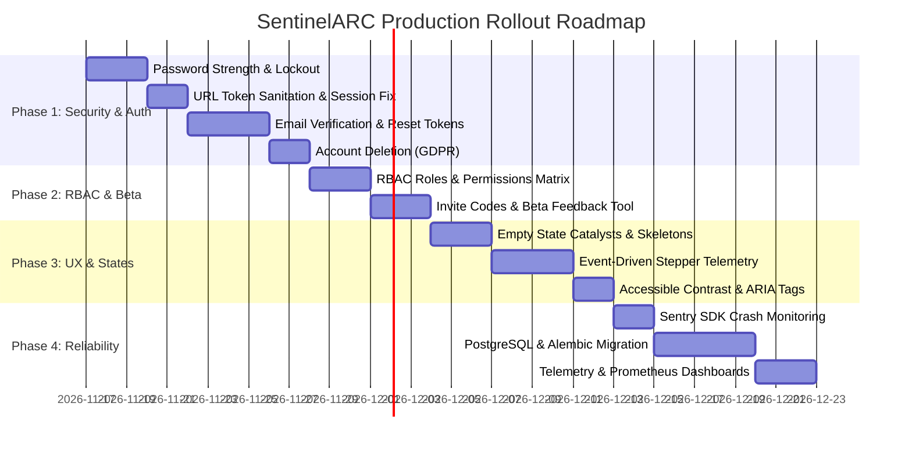

# SentinelARC: Production-Grade Engineering Blueprint & Audit

This blueprint provides an exhaustive architectural audit and production-readiness roadmap across the 14 core capabilities required for SentinelARC to transition from an advanced prototype to an enterprise-grade academic research platform.

---

## 1. System Capability Matrix (Audit & Roadmap)

| # | Aspect | Current State in SentinelARC | Production Gap / Risk | Production-Grade Target Architecture |
|---|---|---|---|---|
| **1** | **Security** | Caddy TLS (Let's Encrypt), bcrypt password hashing, basic session clearing. | No API authentication on FastAPI, no rate-limiting, hardcoded Docker secrets, plain SQLite file without encryption. | Zero-Trust API with HMAC/JWT Bearer tokens, Caddy rate-limiting & CSP headers, Docker secrets manager, secure cookies. |
| **2** | **Signup & Login** | Username + Password form in Streamlit, SHA256-prehashed bcrypt, session tokens in URL. | Token in URL query (`?session=...`) is an OWASP vulnerability; no password strength policy; no account lockout after brute-force attacks. | Cryptographically strong password requirements (zxcvbn/regex), brute-force rate-limiting & exponential lockout, URL token sanitization, session expiration. |
| **3** | **Password Reset** | ❌ Not implemented. | Users unable to self-recover locked or forgotten accounts. | Time-bound (15-min) cryptographically random reset tokens (hashed in DB), secure transactional email delivery, single-use invalidation. |
| **4** | **Email Verification** | ❌ Not implemented (`User` model lacks `email` column). | High risk of fake accounts, bot spam, and inability to deliver critical alerts or report exports. | Email verification state (`is_verified`), unverified user gates, modular email provider (Console logger in Dev $\to$ SMTP/Resend/SendGrid in Prod). |
| **5** | **Account Deletion** | ❌ Not implemented (only individual report deletion exists). | Non-compliant with GDPR Article 17 ("Right to Erasure") and CCPA. | Self-service deletion workflow with mandatory password re-authentication, cascading DB deletion, and complete physical purge of disk artifacts. |
| **6** | **User Permissions (RBAC)**| Flat multi-tenant isolation via `user_id`. | No role hierarchy; every registered user has identical access; no administrator governance. | Role-Based Access Control (`admin`, `researcher`, `beta_tester`, `guest`), permission decorators, dedicated Admin Dashboard. |
| **7** | **Empty States** | Minimal text captions (`No reports yet...`). | Poor first-time user experience (cold-start dropoff), lack of guidance or discoverability. | Interactive onboarding empty states with domain-specific template queries, feature highlights, and clear search-reset fallbacks. |
| **8** | **Loading States** | Static timer-based CSS stepper (`elapsed < 6s`, `elapsed < 16s`). | False step progress if agents encounter network jitter; polling loop with `time.sleep(2)` blocks thread. | Real-time event-driven agent progress telemetry via task progress storage, CSS skeleton shimmer loaders, and non-blocking background polling. |
| **9** | **Error States** | Generic `try...except` with raw error toasts. | Unactionable user feedback; unhandled network or LLM timeouts leave UI hung. | Typed error boundaries (`RateLimitError`, `LLMQuotaExhausted`, `UpstreamTimeout`), exponential backoff retry with jitter, fallback abstract synthesis. |
| **10**| **Data Persistence** | Local SQLite file mounted into container volumes (`output/sentinelarc.db`). | SQLite concurrency locks under concurrent write load; no automated backup; local disk coupling. | Hybrid persistence: PostgreSQL with SQLAlchemy connection pooling + S3/GCS/MinIO blob storage for generated reports & PDFs + automated snapshots. |
| **11**| **Analytics** | Infrastructure metrics via Prometheus & Grafana. | Zero product or user behavioral telemetry; no tracking of query success rates, citation clicks, or export types. | Privacy-preserving Product Telemetry (`analytics_events` table) tracking query latency, domain popularity, export formats, and fact-checking pass rates. |
| **12**| **Crash Reporting** | Stdout/stderr container logs. | Unhandled async exceptions in background tasks fail silently without alert notification. | Centralized crash monitoring via `sentry-sdk` across FastAPI and Streamlit, structured JSON logging with distributed `trace_id` correlation. |
| **13**| **Accessibility (a11y)** | Default Streamlit styling with custom dark stepper. | Low-contrast text ratios ($< 3:1$ in stepper), missing keyboard shortcuts, no ARIA live regions for agent updates. | WCAG 2.1 AA compliance: contrast ratios $> 4.5:1$, screen-reader `aria-live` announcements for synthesis progress, keyboard navigation focus rings. |
| **14**| **Beta Testers** | ❌ Not implemented. | No mechanism to test experimental models or features with select users or collect feedback. | Feature flag management system, invite-code gating during registration, and in-app report feedback widget (rating & comments). |

---

## 2. Deep-Dive Architecture & Production Implementation



---

### Pillar 1: Enterprise Security Architecture

#### Vulnerabilities in Current Prototype
1. **Unprotected Backend Endpoints:** FastAPI endpoints (`/research`, `/general_chat`) accept calls from any client on the internal network without authentication.
2. **Secrets Exposed in Docker Compose:** Hardcoded credentials (`synapse123`) in plain text inside `docker-compose.optimized.yml`.
3. **Missing Reverse Proxy Hardening:** Caddy currently lacks Content Security Policy (CSP), HTTP Strict Transport Security (HSTS), and per-IP rate-limiting.

#### Production Implementation
- **Internal Service Authentication:** Pass an HMAC-signed `X-Service-Token` or JWT in headers from Streamlit to FastAPI.
- **Caddyfile Security Hardening:** Add security headers and rate-limiting directives:

```caddyfile
sentinel-arc.duckdns.org {
    # Rate Limiting: Prevent brute-force & DDoS
    rate_limit {
        zone dynamic_zone {
            key {remote_host}
            events 100
            window 10s
        }
    }

    # Enterprise Security Headers
    header {
        Strict-Transport-Security "max-age=31536000; includeSubDomains; preload"
        X-Content-Type-Options "nosniff"
        X-Frame-Options "SAMEORIGIN"
        Referrer-Policy "strict-origin-when-cross-origin"
        Permissions-Policy "camera=(), microphone=(), geolocation=()"
        Content-Security-Policy "default-src 'self'; script-src 'self' 'unsafe-inline' 'unsafe-eval' https://cdn.jsdelivr.net; style-src 'self' 'unsafe-inline' https://fonts.googleapis.com; font-src 'self' https://fonts.gstatic.com; img-src 'self' data: https:; connect-src 'self' wss: https:;"
    }

    reverse_proxy synapse-streamlit:8501 {
        header_up X-Forwarded-Proto https
        header_up X-Real-IP {remote_host}
    }
}
```

---

### Pillar 2: Signup, Login & Session Management

#### Enhancements
1. **OWASP-Compliant Session Tokens:** Eliminate persistent token display in `st.query_params["session"]`. Immediately after verification, clear query params to prevent token leakage via screenshots, browser history, or referrer headers.
2. **Password Strength Enforcement:** Enforce minimum 8 characters, requiring uppercase, lowercase, numbers, and special characters.
3. **Account Lockout Protection:** Track `failed_login_attempts`. Lock the account for 15 minutes after 5 consecutive failed attempts.
4. **Session Expiration:** Enforce sliding expiration (7 days) for session tokens in the database.

---

### Pillar 3 & 4: Password Reset & Email Verification

#### Database Schema Extension
```python
class User(Base):
    __tablename__ = "users"
    id = Column(Integer, primary_key=True, index=True)
    username = Column(String(50), unique=True, index=True, nullable=False)
    email = Column(String(255), unique=True, index=True, nullable=False)
    password_hash = Column(String(255), nullable=False)
    role = Column(String(30), default="researcher")  # admin, researcher, beta_tester, guest
    is_verified = Column(Boolean, default=False)
    is_active = Column(Boolean, default=True)
    failed_login_attempts = Column(Integer, default=0)
    locked_until = Column(DateTime(timezone=True), nullable=True)
    created_at = Column(DateTime(timezone=True), server_default=func.now())

class PasswordResetToken(Base):
    __tablename__ = "password_reset_tokens"
    id = Column(Integer, primary_key=True, index=True)
    user_id = Column(Integer, ForeignKey("users.id"), nullable=False)
    token_hash = Column(String(64), index=True, nullable=False)  # SHA-256 of plain token
    expires_at = Column(DateTime(timezone=True), nullable=False)
    used = Column(Boolean, default=False)
    created_at = Column(DateTime(timezone=True), server_default=func.now())

class EmailVerificationToken(Base):
    __tablename__ = "email_verification_tokens"
    id = Column(Integer, primary_key=True, index=True)
    user_id = Column(Integer, ForeignKey("users.id"), nullable=False)
    token_hash = Column(String(64), index=True, nullable=False)
    expires_at = Column(DateTime(timezone=True), nullable=False)
    used = Column(Boolean, default=False)
    created_at = Column(DateTime(timezone=True), server_default=func.now())
```

#### Modular Email Service Implementation (`src/services/email_service.py`)
```python
import os
import smtplib
from email.mime.text import MIMEText
from email.mime.multipart import MIMEMultipart
import logging

logger = logging.getLogger(__name__)

class EmailService:
    @staticmethod
    def send_email(to_email: str, subject: str, html_content: str):
        smtp_host = os.getenv("SMTP_HOST")
        smtp_port = int(os.getenv("SMTP_PORT", 587))
        smtp_user = os.getenv("SMTP_USER")
        smtp_pass = os.getenv("SMTP_PASSWORD")
        smtp_from = os.getenv("SMTP_FROM", "no-reply@sentinel-arc.duckdns.org")

        if not smtp_host or not smtp_user:
            # Development / Staging fallback: Log to console & disk
            logger.info(f"📧 [DEV EMAIL SIMULATION] To: {to_email} | Subject: {subject}")
            logger.info(f"Content Preview: {html_content[:200]}...")
            return True

        try:
            msg = MIMEMultipart("alternative")
            msg["Subject"] = subject
            msg["From"] = smtp_from
            msg["To"] = to_email
            msg.attach(MIMEText(html_content, "html"))

            with smtplib.SMTP(smtp_host, smtp_port) as server:
                server.starttls()
                server.login(smtp_user, smtp_pass)
                server.sendmail(smtp_from, to_email, msg.as_string())
            return True
        except Exception as e:
            logger.error(f"Failed to send email to {to_email}: {e}")
            return False
```

---

### Pillar 5: Account Deletion (GDPR / CCPA Compliant)

#### Complete Purge Logic
```python
def delete_user_account(user_id: int, password_confirmation: str) -> Tuple[bool, str]:
    """Permanently delete user profile, sessions, database rows, and physical disk assets."""
    db = SessionLocal()
    try:
        user = db.query(User).filter(User.id == user_id).first()
        if not user:
            return False, "User not found."
        if not user.verify_password(password_confirmation):
            return False, "Incorrect password. Deletion aborted."

        # 1. Purge physical disk assets
        user_reports_dir = Path("output/reports") / str(user_id)
        if user_reports_dir.exists():
            import shutil
            shutil.rmtree(user_reports_dir, ignore_errors=True)

        # 2. Remove any active task flag files
        for flag in Path("output").glob(f"active_task_{user_id}.flag*"):
            flag.unlink(missing_ok=True)

        # 3. Cascade delete database user (cascades to UserSession, Report, Feedback)
        db.delete(user)
        db.commit()
        return True, "Account and all associated research data permanently deleted."
    except Exception as e:
        db.rollback()
        return False, f"Failed to delete account: {e}"
    finally:
        db.close()
```

---

### Pillar 6: Role-Based Access Control (RBAC)

#### Roles & Permissions Hierarchy
- **`admin`**: Full access to System Dashboard, User Management, Audit Logs, Resource Provisioning.
- **`researcher`**: Standard tier. Autonomous Multi-Agent Swarm execution, multi-format exports, custom literature filters.
- **`beta_tester`**: Access to experimental reasoning models, Graph RAG visualizations, and deep research modes.
- **`guest`**: View-only access to curated public research reports; max 1 query per 24 hours.

#### Permission Check Utility
```python
PERMISSIONS = {
    "admin": {"manage_users", "view_audit_logs", "execute_swarm", "beta_features", "export_data"},
    "beta_tester": {"execute_swarm", "beta_features", "export_data"},
    "researcher": {"execute_swarm", "export_data"},
    "guest": {"view_public_reports"}
}

def has_permission(user_role: str, permission: str) -> bool:
    return permission in PERMISSIONS.get(user_role, set())
```

---

### Pillar 7: Production Empty States

#### UX Strategy
Eliminate cold-start dropoff by providing:
1. **Interactive Prompt Chips:** One-click topic catalysts across 4 primary domains.
2. **Workflow Progression Card:** Visual diagram explaining the 5-stage synthesis pipeline.
3. **Filter Zero-State:** Clean fallback UI allowing immediate reset of search queries.

```python
def render_empty_dashboard():
    st.markdown(
        """
        <div style="text-align: center; padding: 48px 24px; background: #ffffff; border: 1px dashed #cbd5e1; border-radius: 16px; margin: 20px 0;">
            <div style="font-size: 42px; margin-bottom: 12px;">🔬</div>
            <h3 style="color: #0f172a; margin-bottom: 8px;">Begin Your First Autonomous Academic Investigation</h3>
            <p style="color: #64748b; font-size: 14px; max-width: 540px; margin: 0 auto 24px auto;">
                SentinelARC coordinates parallel agents to retrieve, extract, fact-check, and synthesize peer-reviewed literature from arXiv, PubMed, OpenAlex, and Crossref.
            </p>
        </div>
        """,
        unsafe_allow_html=True
    )
    st.markdown("##### 💡 Suggested Research Prompts:")
    cols = st.columns(3)
    prompts = [
        ("🤖 Machine Learning", "Mechanistic interpretability of sparse autoencoders in LLMs"),
        ("🧬 Biomedicine", "CRISPR-Cas9 off-target mitigation strategies in vivo"),
        ("⚛️ Quantum Computing", "Surface code error thresholds in neutral atom quantum processors")
    ]
    for idx, (cat, q) in enumerate(prompts):
        with cols[idx]:
            if st.button(f"**{cat}**\n\n{q}", key=f"chip_empty_{idx}", use_container_width=True):
                st.session_state["pending_query"] = q
                st.rerun()
```

---

### Pillar 8: Event-Driven Loading States

#### Eliminating Heuristic Polling
Instead of calculating stage from `elapsed = poll_count * 2`, the agents emit real state transitions into a task ledger:



---

### Pillar 9: Resilient Error States

#### Production Error Handling
- **Categorized Error Classification:**
  - `RateLimitException` (HTTP 429 from Groq or Semantic Scholar) $\rightarrow$ Display countdown timer with automated retry.
  - `PDFExtractionException` $\rightarrow$ Graceful fallback to abstract-level analysis with notification.
  - `TimeoutException` $\rightarrow$ Allow user to resume synthesis or download partial findings.
- **Error Boundary Component:** Never display a raw stack trace to the user; provide diagnostic correlation IDs for support lookup.

---

### Pillar 10: Enterprise Data Persistence

#### Migration from SQLite to PostgreSQL
- **Database Engine:** Transition to managed PostgreSQL (e.g., Supabase or Cloud SQL) using connection pooling (`QueuePool`, `pool_size=10`, `max_overflow=20`, `pool_pre_ping=True`).
- **Object Storage:** Store markdown, PDF, and HTML artifacts in S3/MinIO buckets rather than local host filesystem.
- **Database Migration Tool:** Implement Alembic migrations to automatically version control table schema changes across environments.

---

### Pillar 11: Product Analytics & Telemetry

#### Telemetry Schema (`analytics_events`)
```python
class AnalyticsEvent(Base):
    __tablename__ = "analytics_events"
    id = Column(Integer, primary_key=True, index=True)
    user_id = Column(Integer, ForeignKey("users.id"), nullable=True)
    event_type = Column(String(50), index=True, nullable=False)  # query_started, report_downloaded, source_clicked
    properties = Column(Text, nullable=True)  # JSON metadata (e.g. format="pdf", source_count=12)
    timestamp = Column(DateTime(timezone=True), server_default=func.now())
```

#### Application Performance Gauges
- `sentinelarc_query_latency_seconds` (Histogram across swarm stages)
- `sentinelarc_factcheck_pass_rate` (Gauge monitoring consensus detection accuracy)
- `sentinelarc_daily_active_users` (Counter)

---

### Pillar 12: Centralized Crash Reporting

#### Sentry SDK Integration (`streamlit_app.py` & `async_main.py`)
```python
import sentry_sdk
from sentry_sdk.integrations.fastapi import FastApiIntegration

sentry_dsn = os.getenv("SENTRY_DSN")
if sentry_dsn:
    sentry_sdk.init(
        dsn=sentry_dsn,
        traces_sample_rate=0.2,
        environment=os.getenv("APP_ENV", "production"),
        integrations=[FastApiIntegration()]
    )
```

---

### Pillar 13: Accessibility (WCAG 2.1 AA Compliance)

#### Accessibility Standards Enforced
1. **Color Contrast:** All text must meet a minimum contrast ratio of $4.5:1$ against backgrounds.
2. **Keyboard Focus:** Visible blue focus ring (`:focus-visible { outline: 2px solid #2563eb; }`) on all interactive buttons, inputs, and tabs.
3. **Screen Reader Live Updates:** Stepper progress wrapped in `aria-live="polite"` so screen readers automatically announce stage changes.
4. **Reduced Motion:** Respect `prefers-reduced-motion: reduce` by disabling pulse animations.

---

### Pillar 14: Beta Testing Framework

#### Closed Beta & Feature Flags
- **Invite Codes:** New users must provide an invite code (`INVITE-RESEARCH-2026`) during closed beta registration.
- **Feedback Collection Modal:** Inline rating (1-5 stars) and qualitative feedback field under every synthesized report.

```python
class Feedback(Base):
    __tablename__ = "report_feedback"
    id = Column(Integer, primary_key=True, index=True)
    user_id = Column(Integer, ForeignKey("users.id"), nullable=False)
    report_id = Column(Integer, ForeignKey("reports.id"), nullable=False)
    rating = Column(Integer, nullable=False)  # 1 to 5
    aspect = Column(String(50), nullable=True) # "accuracy", "synthesis", "sources"
    comment = Column(Text, nullable=True)
    created_at = Column(DateTime(timezone=True), server_default=func.now())
```

---

## 3. Phased Implementation Strategy


